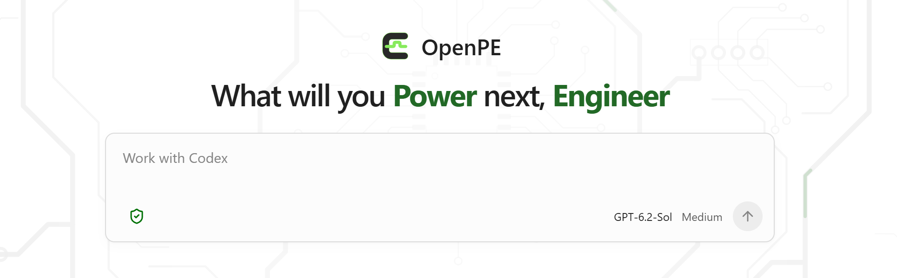

# OpenPE

**Power electronics, from conversation to circuit.**

OpenPE · Electrical Engineering Studio places Agent conversations beside editable electrical designs in a local desktop workbench.

## One workspace for your design

- **Design in native KiCad.** Edit schematics, place and route PCBs manually, work with Source, and run bounded ERC/DRC checks.
- **See it in 3D.** Inspect your board, draw custom symbols and footprints, and create Model CAD solids.
- **Explore circuit behaviour.** Run supported SPICE transients, estimate PCB temperature and measure two-terminal PCB parasitics.
- **Review EMC layout evidence.** Declare PCB intent, inspect geometric findings, locate affected objects and record manual reviews, justified exceptions and reports with [EMC Analysis](docs/EMC.md).
- **Work with an Agent.** Use scoped project tools with Codex, Claude Code or Cursor, or review proposals from DeepSeek Harness and Pi. [Raw KiCad mode](DESIGN.md#settings-and-appearance) pauses the workbench and sends selected native files directly from a chat-only view.
- **Extend the workbench.** Install local JavaScript plugins with declared inputs and optional project read access. See the [plugin SDK](docs/PLUGINS.md#plugin-packages-and-sdk).
- **Keep your work local.** Manage independent projects and conversations, recover design drafts and compare local Git history.

Start with a curated example or your own circuit. Save a portable KiCad project with its supporting assets. Manual editing and simulation work without an Agent.

## Get OpenPE

The v0.1.0 Beta publishes unsigned installers for **Windows x64** and **macOS arm64** on [Releases](https://github.com/Open-Power-Electronics/OpenPE/releases). **Linux x64** is not yet published as an installer or solver download. Linux users [run from source](docs/DEVELOPMENT.md#run-from-source) and build solvers locally with the [Linux solver build steps](docs/DEVELOPMENT.md#maintainer-solver-builds). See the [installation guide](docs/DEVELOPMENT.md#install-the-app) for host requirements.

Use Node.js 24 and Git to [run from source](docs/DEVELOPMENT.md#run-from-source). The development guide also covers browser mode, offline solver preparation, checks and packaging.

## Learn more

[Documentation](docs/README.md) · [Examples](docs/EXAMPLES.md) · [Architecture](docs/ARCHITECTURE.md) · [Coverage and limits](docs/README.md#coverage-and-limits) · [Contributing](CONTRIBUTING.md)

## License

[Apache-2.0](LICENSE). Third-party assets retain their licenses and attribution.
