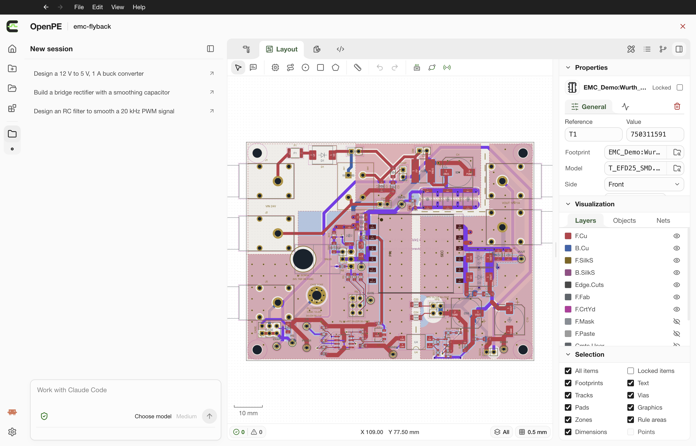
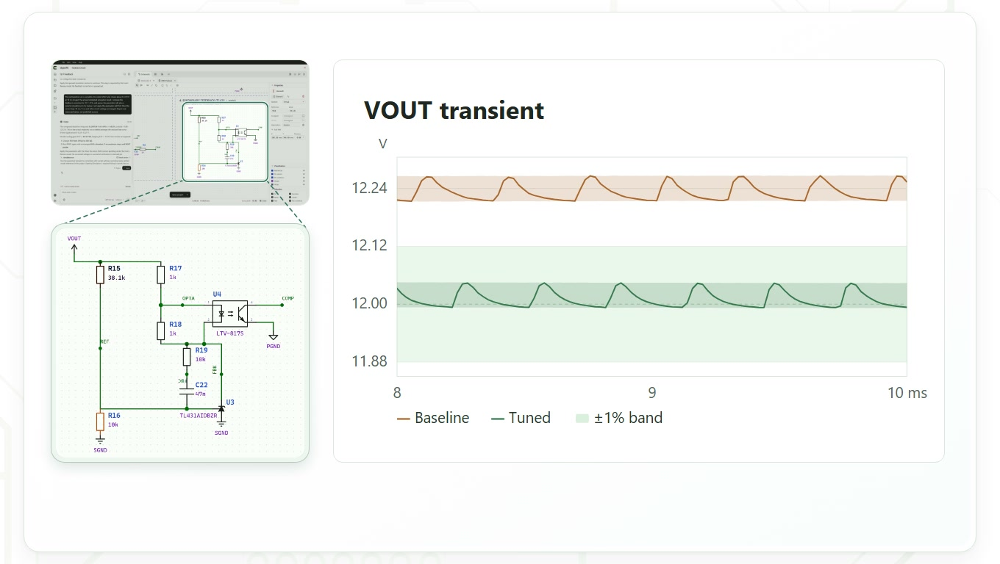
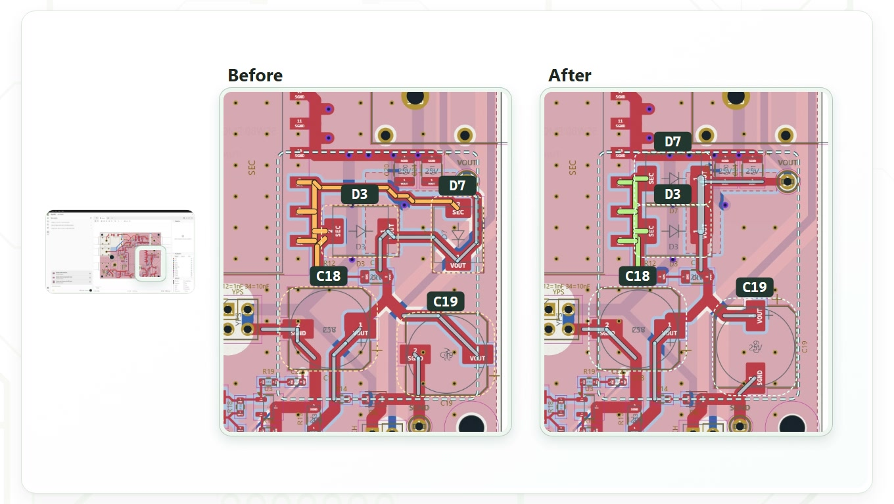
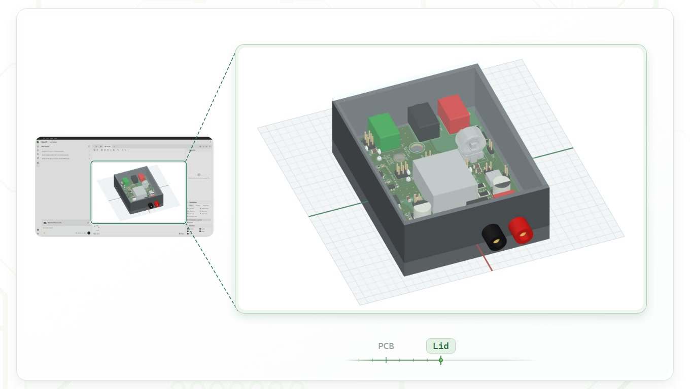

<p align="center">
  <picture>
    <source media="(prefers-color-scheme: dark)" srcset="public/brand/openpe-lockup-dark.png">
    
  </picture>
</p>

<p align="center">
  <strong>AI-native workbench for the power electronics engineer.</strong>
</p>

<p align="center">
  <a href="https://github.com/Open-Power-Electronics/OpenPE/actions/workflows/ci.yml"></a>
  <a href="https://github.com/Open-Power-Electronics/OpenPE/releases"></a>
  <a href="LICENSE"></a>
  
</p>

<p align="center">
  <a href="https://open-power-electronics.github.io/">Website</a> ·
  <a href="https://github.com/Open-Power-Electronics/OpenPE/releases">Download</a> ·
  <a href="docs/README.md">Documentation</a> ·
  <a href="CONTRIBUTING.md">Contributing</a>
</p>

<p align="center">
  <b>English</b> · <a href="README.zh-CN.md">简体中文</a>
</p>

OpenPE · Electrical Engineering Studio is an open-source desktop app for power-electronics design. The Agent conversation sits on the left. Schematic, PCB layout, Model and native KiCad source sit on the right, in one local project.



OpenPE works on native KiCad 10 files and bundles OpenCASCADE, ngspice, Gmsh and Elmer. Manual editing and supported simulation work without an Agent. Coverage is bounded: OpenPE does not claim general KiCad import, complete ERC/DRC parity, autorouting or production qualification. See [Coverage and limits](docs/README.md#coverage-and-limits).

## Highlights

<table>
  <tr>
    <td width="33%" valign="top">
      
      <p><b>Schematic and simulation.</b> Edit the circuit, draw custom symbols and run a supported ngspice transient.</p>
    </td>
    <td width="33%" valign="top">
      
      <p><b>PCB layout.</b> Place and route the board manually, draw custom footprints and inspect it in 3D.</p>
    </td>
    <td width="33%" valign="top">
      
      <p><b>Model CAD.</b> Create bounded CAD solids around the board and export enclosure STEP.</p>
    </td>
  </tr>
</table>

## Features

- **Native KiCad projects.** Edit `.kicad_sch` and `.kicad_pcb` directly, work in Source, and save a portable project with its supporting assets.
- **Bounded checks.** Run read-only ERC and DRC within the documented [design rules](docs/DESIGN-RULES.md).
- **One project, three views.** Schematic, Layout and Model share one native project and one undo history.
- **Local Agents.** Discuss the open project and request edits from an Agent you already run.
- **Built-in analysis.** Simulation, board temperature, parasitics and EMC review run as plugins on the same project.
- **Local by default.** Manage independent projects and conversations, recover design drafts and compare local Git history.

## Agents

OpenPE connects to Agent runtimes you install separately. Access depends on the Agent:

| Agent | Access |
| --- | --- |
| Codex | Scoped tools on the open schematic, PCB layout, Model CAD and supported simulation |
| Claude Code | Scoped tools on the open schematic, PCB layout, Model CAD and supported simulation |
| Cursor | Scoped tools on the open schematic, PCB layout, Model CAD and supported simulation |
| DeepSeek Harness | Project context and proposals |
| Pi | Project context and proposals |

[Raw KiCad mode](DESIGN.md#settings-and-appearance) pauses the workbench and sends selected native files from a chat-only view. Projects stay on disk as native KiCad files. The provider you choose receives the prompts and context you send. See [Agent tools](docs/API.md#agent-tools).

## Built-in plugins

| Plugin | What it does | Limits |
| --- | --- | --- |
| [SPICE Simulation](docs/SIMULATION.md) | Runs supported transients and shows waveforms | Bundled ngspice 47; not production validation |
| [Layout Thermal](docs/THERMAL.md) | Estimates steady PCB temperature with Gmsh and Elmer | Board temperature, not junction temperature; no airflow model |
| [Layout Parasitics](docs/LAYOUT.md) | Measures two-terminal DC resistance and partial inductance | Same-net pads or vias; no return path |
| [EMC Analysis](docs/EMC.md) | Reviews PCB geometry for EMC risks and records reports | A design review, not an emission or compliance verdict |
| PE Layout Skill | Gives Agents power-electronics PCB design guidance | Guidance only; not an autorouter |

You can also install a local JavaScript plugin with declared inputs and optional project read access. See the [plugin SDK](docs/PLUGINS.md#plugin-packages-and-sdk).

## Install

| Platform | Installer | Status |
| --- | --- | --- |
| Windows x64 | `OpenPE-0.1.1-x64.exe` | v0.1.1 Beta, unsigned |
| macOS arm64 | `OpenPE-0.1.0-arm64.dmg` | v0.1.0 Beta, unsigned and not notarized |
| Linux x64 | None yet | Run from source and build solvers locally |

Download installers from [Releases](https://github.com/Open-Power-Electronics/OpenPE/releases). The [installation guide](docs/DEVELOPMENT.md#install-the-app) covers first launch and host requirements. Linux users follow the [Linux solver build steps](docs/DEVELOPMENT.md#maintainer-solver-builds).

### Run from source

Requires Node.js 24 and Git.

```sh
git clone https://github.com/Open-Power-Electronics/OpenPE.git
cd OpenPE
npm ci
npm run libraries:download
npm run dev
```

The [development guide](docs/DEVELOPMENT.md#run-from-source) also covers browser mode, offline solver preparation, checks and packaging.

## Documentation

| I want to | Read |
| --- | --- |
| Install or run OpenPE | [Setup and development](docs/DEVELOPMENT.md) |
| Know what is supported | [Coverage and limits](docs/README.md#coverage-and-limits) |
| Start from an example | [Examples](docs/EXAMPLES.md) |
| Edit PCB and Model geometry | [Layout and Model](docs/LAYOUT.md) |
| Run simulation or thermal analysis | [SPICE Simulation](docs/SIMULATION.md), [Layout Thermal](docs/THERMAL.md) |
| Review EMC | [EMC Analysis](docs/EMC.md) |
| Write a plugin | [Plugins](docs/PLUGINS.md) |
| Understand the system | [Architecture](docs/ARCHITECTURE.md) |
| Browse everything | [Documentation index](docs/README.md) |

## Contributing

Bug reports are welcome through [GitHub issues](https://github.com/Open-Power-Electronics/OpenPE/issues). Code changes currently come from the OpenPE core team. See [Contributing](CONTRIBUTING.md).

## Team

OpenPE is developed by contributors from leading universities around the world.

**Authors:** Xiao Yang · Yukang Zhu · Wenhao Deng · Tian Xia · Chengmin Li · Dongsheng Yang · Tailin Wu

**Universities:** University of California, Berkeley · University of California, Los Angeles · Massachusetts Institute of Technology · University of Glasgow · Eindhoven University of Technology · Westlake University

## Acknowledgements

OpenPE builds on KiCad file formats, ngspice, Open CASCADE, Gmsh and Elmer. Their notices are in [`public/licenses/`](public/licenses/).

## License

[Apache-2.0](LICENSE). Third-party assets retain their licenses and attribution.
