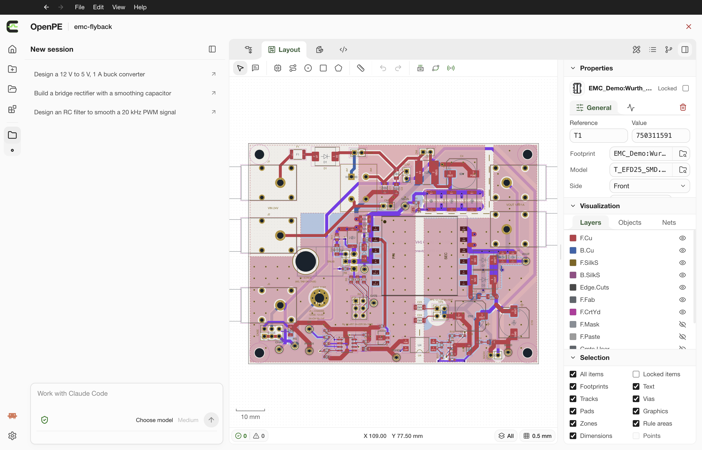
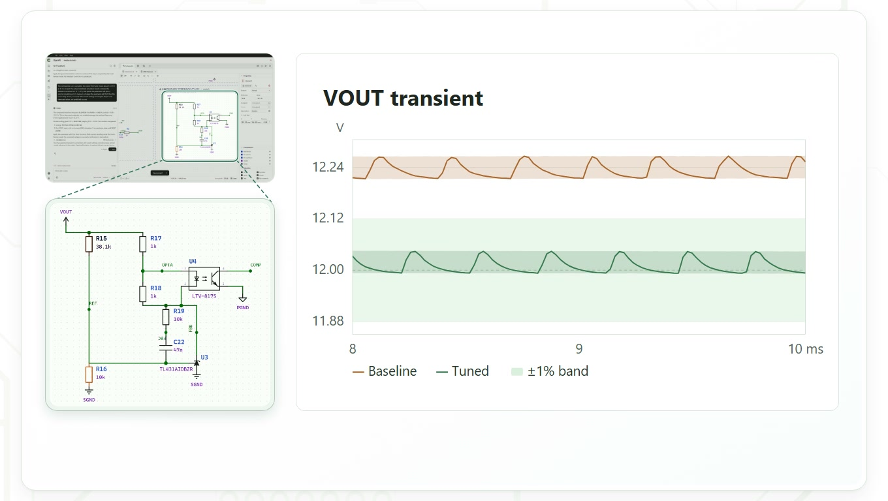
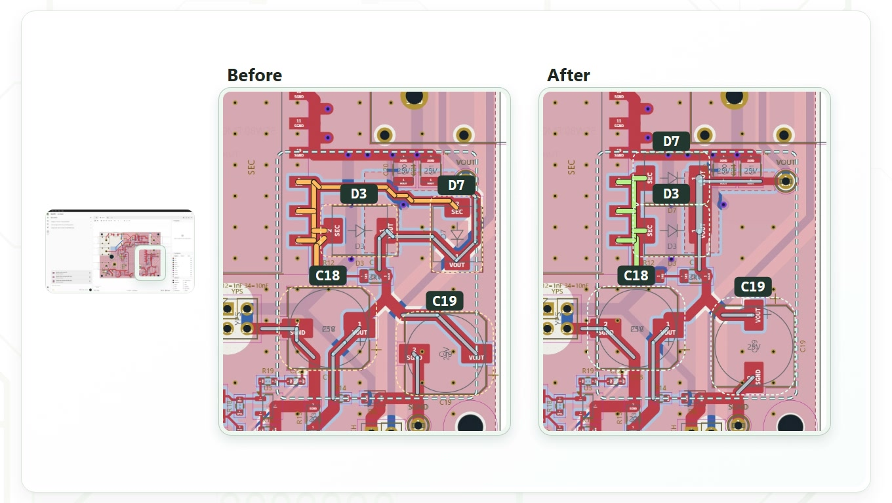
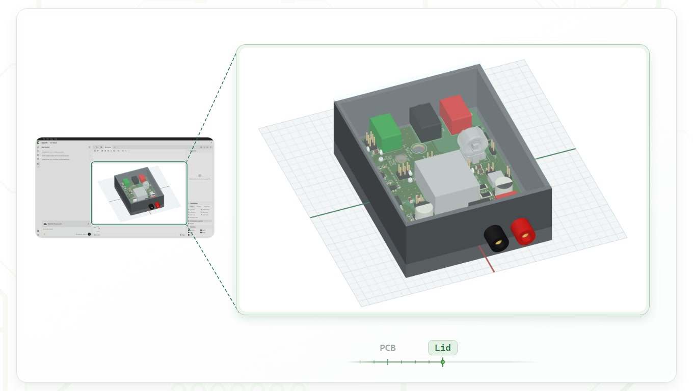

<p align="center">
  <picture>
    <source media="(prefers-color-scheme: dark)" srcset="public/brand/openpe-lockup-dark.png">
    
  </picture>
</p>

<p align="center">
  <strong>面向电力电子工程师的 AI 原生工作台。</strong>
</p>

<p align="center">
  <a href="https://github.com/Open-Power-Electronics/OpenPE/actions/workflows/ci.yml"></a>
  <a href="https://github.com/Open-Power-Electronics/OpenPE/releases"></a>
  <a href="LICENSE"></a>
  
</p>

<p align="center">
  <a href="https://open-power-electronics.github.io/">官网</a> ·
  <a href="https://github.com/Open-Power-Electronics/OpenPE/releases">下载</a> ·
  <a href="docs/README.md">文档</a> ·
  <a href="CONTRIBUTING.md">参与贡献</a>
</p>

<p align="center">
  <a href="README.md">English</a> · <b>简体中文</b>
</p>

> 本文是 [README.md](README.md) 的简体中文翻译，两者内容保持一致。链接指向的项目文档为英文。

OpenPE · Electrical Engineering Studio 是一款开源的电力电子设计桌面软件。左侧是 Agent 对话，右侧是原理图、PCB 布局、Model 和原生 KiCad 源文件，全部在同一个本地工程中。



OpenPE 直接处理原生 KiCad 10 文件，并内置 OpenCASCADE、ngspice、Gmsh 和 Elmer。不连接 Agent 也可以手动编辑和运行受支持的仿真。支持范围是有界的：OpenPE 不声称支持通用 KiCad 导入、与 KiCad 完全一致的 ERC/DRC、自动布线或生产级认证。详见 [Coverage and limits](docs/README.md#coverage-and-limits)。

## 亮点

<table>
  <tr>
    <td width="33%" valign="top">
      
      <p><b>原理图与仿真。</b>编辑电路、绘制自定义符号，并运行受支持的 ngspice 瞬态仿真。</p>
    </td>
    <td width="33%" valign="top">
      
      <p><b>PCB 布局。</b>手动布局布线、绘制自定义封装，并在 3D 中查看电路板。</p>
    </td>
    <td width="33%" valign="top">
      
      <p><b>Model CAD。</b>围绕电路板创建有界的 CAD 实体，并导出外壳 STEP。</p>
    </td>
  </tr>
</table>

## 功能

- **原生 KiCad 工程。**直接编辑 `.kicad_sch` 和 `.kicad_pcb`，可在 Source 中修改源文件，并保存为带配套资源、可移植的工程。
- **有界检查。**在文档规定的[设计规则](docs/DESIGN-RULES.md)范围内运行只读的 ERC 和 DRC。
- **一个工程，三个视图。**原理图、Layout 和 Model 共用同一个原生工程和同一条撤销历史。
- **本地 Agent。**与你已在使用的 Agent 讨论当前工程，并请求它修改设计。
- **内置分析。**仿真、板温、寄生参数和 EMC 评审以插件形式运行在同一个工程上。
- **默认本地。**管理相互独立的工程与对话，恢复设计草稿，比较本地 Git 历史。

## Agent

OpenPE 连接你单独安装的 Agent 运行时。不同 Agent 的权限如下：

| Agent | 权限 |
| --- | --- |
| Codex | 对当前原理图、PCB 布局、Model CAD 和受支持的仿真使用限定范围的工具 |
| Claude Code | 对当前原理图、PCB 布局、Model CAD 和受支持的仿真使用限定范围的工具 |
| Cursor | 对当前原理图、PCB 布局、Model CAD 和受支持的仿真使用限定范围的工具 |
| DeepSeek Harness | 读取工程上下文并提出修改建议 |
| Pi | 读取工程上下文并提出修改建议 |

[Raw KiCad 模式](DESIGN.md#settings-and-appearance)会暂停工作台，在纯对话视图中直接发送所选的原生文件。工程以原生 KiCad 文件保存在本地磁盘上。你选择的服务商会收到你发送的提示词和上下文。详见 [Agent tools](docs/API.md#agent-tools)。

## 内置插件

| 插件 | 作用 | 边界 |
| --- | --- | --- |
| [SPICE Simulation](docs/SIMULATION.md) | 运行受支持的瞬态仿真并显示波形 | 内置 ngspice 47；不作为生产验证 |
| [Layout Thermal](docs/THERMAL.md) | 用 Gmsh 和 Elmer 估算 PCB 稳态温度 | 是板温而非结温；不含气流模型 |
| [Layout Parasitics](docs/LAYOUT.md) | 测量两端之间的直流电阻和部分电感 | 限同网络的焊盘或过孔；不含回流路径 |
| [EMC Analysis](docs/EMC.md) | 检查 PCB 几何中的 EMC 风险并记录报告 | 属于设计评审，不给出辐射或合规结论 |
| PE Layout Skill | 为 Agent 提供电力电子 PCB 设计指导 | 仅为指导；不是自动布线器 |

你也可以安装本地 JavaScript 插件，插件需声明输入，并可选择申请工程读取权限。详见 [plugin SDK](docs/PLUGINS.md#plugin-packages-and-sdk)。

## 安装

| 平台 | 安装包 | 状态 |
| --- | --- | --- |
| Windows x64 | `OpenPE-0.1.1-x64.exe` | v0.1.1 Beta，未签名 |
| macOS arm64 | `OpenPE-0.1.1-arm64.dmg` | v0.1.1 Beta，本地临时签名，未经 Apple 公证 |
| Linux x64 | 暂未发布 | 从源码运行，并在本地构建求解器 |

安装包可从 [Releases](https://github.com/Open-Power-Electronics/OpenPE/releases) 下载。首次启动和系统要求见[安装指南](docs/DEVELOPMENT.md#install-the-app)。Linux 用户请按 [Linux solver build steps](docs/DEVELOPMENT.md#maintainer-solver-builds) 操作。

### 从源码运行

需要 Node.js 24 和 Git。

```sh
git clone https://github.com/Open-Power-Electronics/OpenPE.git
cd OpenPE
npm ci
npm run libraries:download
npm run dev
```

[开发指南](docs/DEVELOPMENT.md#run-from-source)还介绍了浏览器模式、离线准备求解器、检查和打包。

## 文档

| 我想要 | 阅读 |
| --- | --- |
| 安装或运行 OpenPE | [Setup and development](docs/DEVELOPMENT.md) |
| 了解支持范围 | [Coverage and limits](docs/README.md#coverage-and-limits) |
| 从示例开始 | [Examples](docs/EXAMPLES.md) |
| 编辑 PCB 和 Model 几何 | [Layout and Model](docs/LAYOUT.md) |
| 运行仿真或热分析 | [SPICE Simulation](docs/SIMULATION.md)、[Layout Thermal](docs/THERMAL.md) |
| 做 EMC 评审 | [EMC Analysis](docs/EMC.md) |
| 编写插件 | [Plugins](docs/PLUGINS.md) |
| 理解系统架构 | [Architecture](docs/ARCHITECTURE.md) |
| 浏览全部文档 | [Documentation index](docs/README.md) |

## 参与贡献

欢迎通过 [GitHub issues](https://github.com/Open-Power-Electronics/OpenPE/issues) 报告问题。代码改动目前由 OpenPE 核心团队完成。详见 [Contributing](CONTRIBUTING.md)。

## 团队

OpenPE 由来自全球多所知名高校的贡献者共同开发。

**作者：** Xiao Yang · Yukang Zhu · Wenhao Deng · Tian Xia · Chengmin Li · Dongsheng Yang · Tailin Wu

**院校：** 加州大学伯克利分校 · 加州大学洛杉矶分校 · 麻省理工学院 · 格拉斯哥大学 · 埃因霍温理工大学 · 西湖大学

## 致谢

OpenPE 基于 KiCad 文件格式、ngspice、Open CASCADE、Gmsh 和 Elmer 构建，它们的许可声明位于 [`public/licenses/`](public/licenses/)。

## 许可证

[Apache-2.0](LICENSE)。第三方资源保留各自的许可证和署名。
