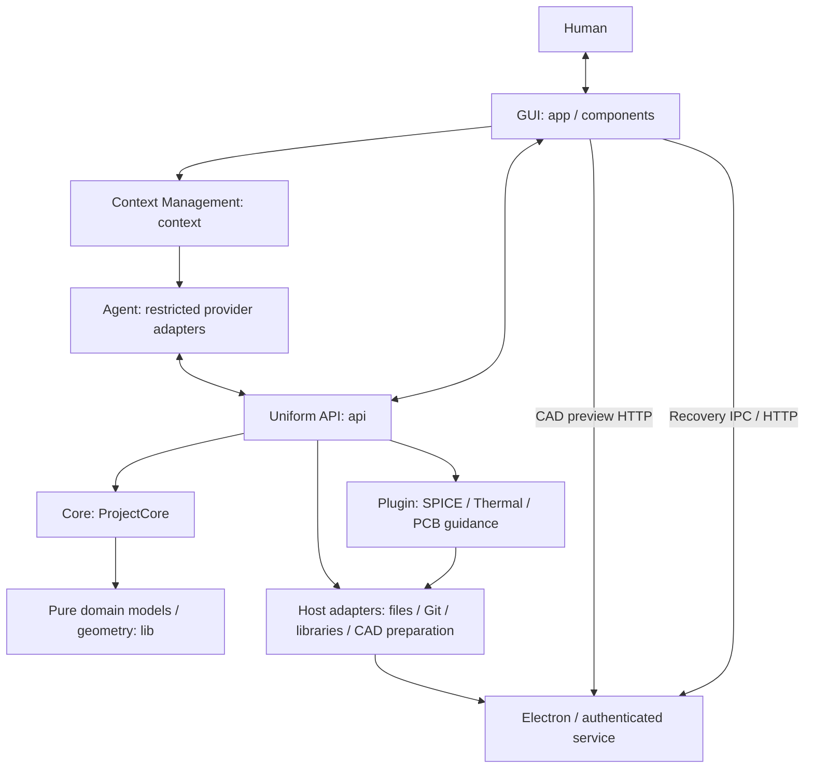
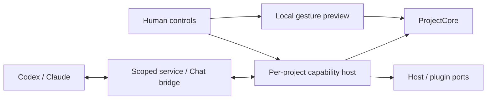

# OpenPE architecture and subsystem boundaries

[assets/architecture.drawio](../assets/architecture.drawio) is the architecture source. This document maps its implemented modules to ownership, trust, storage and execution paths.

The separate [architecture vision](../assets/vision.drawio) retains the original Page-2 concept and an adapted future direction. Its dashed goals do not define current capabilities; [assets/README.md](../assets/README.md) explains the two sheets.

OpenPE is an Electron desktop application with a Next.js/React renderer and authenticated loopback Express service. Packaged Express runs in Electron's main process. Bundled SPICE Simulation, Thermal FEM and PE Layout Skill share this application/source tree with independent lifecycle gates; there is no general workbench extension loader or separate plugin sandbox.

[Core](CORE.md) owns transactions; [API](API.md) owns executable schemas/transports; [Format](FORMAT.md) owns native content; [Design](../DESIGN.md) owns visual interaction. [README](../README.md) covers setup and [AGENTS](../AGENTS.md) defines engineering/check requirements. Feature contracts own their detailed algorithms and UI-independent limits.

## Architecture layers

Arrows describe calls/responsibility, not processes. Core events and validated reads return through the shared host. Local GUI previews commit through the same transaction owner; the catalog advertises supported automation, not every pointer or camera movement.

| Layer               | Implementation                                                                                       | Boundary                                                                        |
| ------------------- | ---------------------------------------------------------------------------------------------------- | ------------------------------------------------------------------------------- |
| GUI                 | `app/`, `components/`; DesktopWorkspace/Workbench                                                    | Presentation, gestures, Source text history and retained editors and Git window |
| Context Management  | `context/agent-*-context.ts`, `context/agent-presentation.ts`                                        | Bounded observed data/capture; no document mutations                            |
| Agent               | Chat, provider catalog, `server/agents.mjs` and restricted adapters                                  | Origin-bound process/stream/tool adaptation and reviews                         |
| Uniform API         | `api/capabilities.ts`, `api/capability-schema.ts`                                                    | Independent schemas, discovery, dispatch, cancellation/events                   |
| Core                | `core/project-core.ts`, command registrations, pure `lib/` domain code                               | Immutable accepted document, drafts, revisions and whole-project undo           |
| Plugin              | Feature capabilities/components, `server/spice*.mjs`, `server/thermal*.mjs`, `server/pcb-design.mjs` | Bundled feature lifecycle, compilation, execution and private results           |
| Host infrastructure | `electron/`, `server/` and named `lib/*-capabilities.ts` ports                                       | Grants, persistence, native dialogs, verified resources and process I/O         |

### Core abstraction levels

Capability `owner` distinguishes Core, host, plugin and API; `level` classifies Core design command abstraction independently of review/mutation policy.

| Level     | Implemented use                                                |
| --------- | -------------------------------------------------------------- |
| Object    | Direct component, field, track, zone and CAD-object edits      |
| Operation | Composed connectivity, routing, transforms and project editing |
| Task      | No registered task-level design automation                     |

Queries/infrastructure/view controls need no Core level. Metadata grants no permissions. [API](API.md) defines the exact catalog.

### Supported artifacts

The host reads/writes bounded native KiCad projects, exports manufacturing Gerber/drill ZIP and assembly CSV, and exports Model CAD as analytical STEP or OpenSCAD text. Source edits supporting text and displays local PDFs through grant-bound host adapters. Recovery, Git history and SPICE/thermal records remain private stores; snapshots are internal adapters, never public design formats. PE Layout Skill supplies bundled guidance. Transient SPICE and steady PCB thermal execution remain distinct from whole-assembly 3D simulation.

## Repository management

| Location                          | Responsibility                                            | Main contract                                         |
| --------------------------------- | --------------------------------------------------------- | ----------------------------------------------------- |
| `api/`                            | Framework-independent Uniform API                         | [API](API.md), [Core](CORE.md)                        |
| `context/`                        | Agent observations and presentation capture               | [Core](CORE.md)                                       |
| `core/`                           | Immutable document owner/commands                         | [Core](CORE.md)                                       |
| `app/`, `components/`, `public/`  | Renderer, shared controls and product assets              | [Design](../DESIGN.md)                                |
| `lib/`                            | Domain/geometry/format and explicitly named host adapters | [Format](FORMAT.md), [Layout](LAYOUT.md)              |
| `server/`, `electron/`            | Service/native/providers/plugins/solvers/persistence      | [API](API.md) and feature contracts                   |
| `examples/`                       | Ten complete native projects and controller references    | [Examples](EXAMPLES.md), [Format](FORMAT.md)          |
| `resources/`                      | Shared catalog, pinned sources/assets and host resources  | [Examples](EXAMPLES.md), [Libraries](LIBRARIES.md)    |
| `tests/`, `scripts/`              | Regressions, generators and opt-in integrations           | [Engineering](../AGENTS.md#verification-and-delivery) |
| `assets/`, `docs/`, root Markdown | Architecture source, subsystem/design/setup contracts     | This map                                              |
| `references/`                     | Research snapshots; never imported runtime styling        | [Reference boundaries](../references/README.md)       |

`npm run check:architecture` checks imports/re-exports and transitive runtime dependencies, including generated modules. It rejects Node/service/native imports in the renderer, UI/I/O reachable from Core, reverse implementation dependencies from API, Context mutations and host imports of live renderer/engine code. Explicit exceptions document concrete ownership reasons. It runs before typecheck/tests/build.

Changes identify their layer, update the owning contract and regenerate formats from TypeScript. Update the diagram when ownership, execution or artifacts change. Import checks establish module boundaries, not electrical correctness or runtime security.

## Process and trust boundaries

- Electron starts the service and owns native dialogs, resource roots and live opaque project grants. It establishes application data under `OpenPE`, or the explicit `OPENPE_DATA_DIR` override, before applying the native OpenPE name. Former-brand directories and contracts have no migration or fallback.
- The renderer is static-exported in packaged builds, or uses the local Next.js dev server. It imports no Node APIs; Electron keeps context isolation/sandboxing.
- `window.openpe` is a narrow preload bridge. Native calls verify the originating main frame and resolve grants. Host filesystem destinations and grant IDs never enter projects or recovery; native model paths and portable relative references remain valid design metadata.
- `electron/spice-model-picker.cjs` opens a single native SPICE file picker for a live project grant, including an unsaved project. The current library may supply a bounded display-only dialog location. Explicit local selection returns its path and bounded declaration metadata, with frame/grant and regular-file checks; it creates no general renderer file-read or solver authority. The same module automatically inspects project-relative libraries through a private bounded directory observation and the shared declaration scanner. The scanner hides helper dependencies and uses generated exact-hash public-entry metadata from canonical TI/reference records for pinned vendor libraries; absolute external references require native selection. This read returns metadata only and leaves Core, undo and native bytes unchanged. Properties applies the selected binding through Core. External references stay external through Save, recovery and history.
- Express binds loopback and validates hosts/origins/request bounds. Renderer APIs/SSE/tool results require process authentication. The separate Agent bridge uses a scoped turn token; one-time result tokens also bind request/run/session/origin.
- Provider CLIs and solvers use restricted child-process adapters. Library indexing and STEP conversion use bounded workers. These are implementation mechanisms, not independent plugin processes.
- Codex/Claude expose live OpenPE tools only; DeepSeek/Pi use context-only protocols and Cursor is detection-only. UI Review/Auto cannot bypass provider restrictions or native grants.

STEP conversion uses bounded reusable OCCT worker threads with fixed tessellation; [STEP access](LIBRARIES.md#step-access-and-previews) owns their reuse, timeout and memory limits. Mesh results are bounded and carry no document authority.

## Ownership

| State/data                                                                                                     | Owner                                                                     |
| -------------------------------------------------------------------------------------------------------------- | ------------------------------------------------------------------------- |
| Accepted native model, Source drafts, revisions, undo and validated simulation design attributes               | ProjectCore                                                               |
| Viewports, selection, CodeMirror history, ordinary-file drafts, local inspector/tool drafts and dirty baseline | Workbench/editor presentation                                             |
| Open-project selection, admission and queued recovery                                                          | DesktopWorkspace                                                          |
| Capability discovery/schemas/availability/events                                                               | Per-project capability host                                               |
| Native destinations, grants, Save/export and Git storage                                                       | Electron/service host ports                                               |
| Installed/enabled workbench lifecycle and provider installation receipts                                       | Separate host stores/adapters                                             |
| Solver compilation, private execution derivatives, settings/results/probes                                     | Respective bundled simulation feature                                     |
| Reviewed controller datasheets                                                                                 | Host reference adapter; internal resource catalog, outside document state |
| PE Layout Skill workflow/reference loading and turn injection                                                  | Bundled plugin plus host infrastructure                                   |

Simulation participation, model mappings and portable model references remain native data editable through Source/Core commands, undoable and exportable while SPICE is unavailable. The Schematic SPICE Simulation action, Properties parameter section and settings-dock participation switches require confirmed installed/enabled plugin state; Layout has no SPICE controls. Plugin removal cannot remove document attributes or portable files. Model selection/execution belongs to SPICE; hash-checked copying/Save portability belongs to host persistence. The native model picker inspects only its explicitly selected bounded file and returns declarations/issues without bodies or include access; pure binding checks validate symbols and model ports. Active model source is Core data, while declaration catalogs remain renderer presentation.

Model CAD parameters belong to Core and native `.kicad_pro` settings. Sketches on the shared Model canvas and local tool/property previews belong to presentation. `lib/model-cad.ts` owns bounded profiles, semantic base-edge catalogues, extrusion/edge-treatment/Boolean recipes, conservative envelopes and canonical geometry keys. `lib/model-cad-selection.ts` owns pure typed selection, geometry eligibility filters and stale-entity pruning; `components/model-cad-edges.ts` and `components/model-cad-faces.ts` own visible analytic topology picking and disposable highlights. These adapters store no document mutations. Boolean operand roles remain presentation until the existing two-body Core command commits. `core/register-project.ts` wraps human/Agent commands with asynchronous host preflight; `ProjectCore` remains pure and rejects changed advanced geometry without an exact privately retained prepared key. Unchanged geometry permits pose/material edits; Source apply and whole-project replacement use the same gate. Native admission remains structural so imported data is preserved before lazy preview.

File Export selects a manufacturing/exchange format independently of native Save. Pure `lib/manufacturing-export.ts`, `lib/manufacturing-gerber.ts` and `lib/export-zip.ts` compile the current native backing into bounded Gerber X2/Excellon ZIP, JLCPCB ZIP or assembly CSV; `server/manufacturing-format.mjs` is their generated host facade sharing the project validator. `electron/native-export.cjs` validates requests, protects open sources/linked destinations and writes one compiled file after a format-specific picker. The renderer browser download uses the same pure compiler. Pinned Newstroke glyphs and their source/license travel with the application; no runtime KiCad CLI, network lookup or supplier mapping is used. Export leaves design destination/baseline unchanged; Source application remains a Core transaction. [Format](FORMAT.md#manufacturing-export) owns coverage and bounds.

Authenticated `/api/model-cad/preview` passes one validated object to `server/model-cad-kernel.mjs`. Fixed bundled Gmsh/OpenCASCADE construction produces analytical STEP, then the bundled STEP parser returns bounded local meshes. `server/enclosure-step.mjs` reuses the same construction for native STEP export, preserving independent bodies. Retired enclosure extensions are rejected. Preview cancellation/failure stays retryable; meshes and preparation receipts never enter native design or recovery. This host geometry service is independent of simulation plugins and runs no solve. Explicit treatments resolve semantic base-edge bounds to exactly one current OCC curve; ambiguous or missing edges fail. No arbitrary programs, executables, paths, imported/Boolean topology editing or new simulation authority are exposed. File Export's OpenSCAD type runs pure `lib/model-cad-scad.ts` in the Electron export adapter over the host-parsed snapshot: boxes, cylinders, extrusions, local-Z holes and Boolean recipes keep their XYZ poses, edge treatments are rejected and circles are faceted. Source can edit SCAD as ordinary text; OpenPE does not import it as Model CAD or execute it.

ERC/DRC are pure, lazy Core queries. Reports, thresholds and locate markers are presentation, independent of simulation lifecycle. [Design rules](DESIGN-RULES.md) defines supported coverage and partial-report semantics.

Thermal settings/fields stay in the feature session. Workbench publishes generic analysis-panel/drawing/readout slots to Layout; Layout displays the selected-surface raster and real-node probes in its existing camera without storing fields as PCB data or introducing another execution path.

EMC Flyback uses the same host-owned portable-model resolution as the other SPICE projects. Its four checked-in `examples/emc-flyback/circuits/*.lib` files provide model bodies; the pure compiler emits only fixed model IDs/includes. A generated hash lock joins the shared allowlist. Electron supplies the original or packaged example root to the model store; neither renderer requests nor native text select a model resource root.

EMC Flyback’s external electrical testbench is native Core-owned schematic content: V1/R21 feed VBUS, V2 supplies VCC, and R22/I1 load VOUT. The pure compiler stamps those accepted values and source waveforms instead of injecting supplies or loads. Footprint-free bench components have no PCB packages and contribute no PCB heat.

## Shared capability path

Host calls apply schemas, availability, revision and lifecycle checks before handlers. Core validates domain candidates and commits one transaction. Context reads current accepted state and bounded presentation through browser-safe ports; it cannot mutate design.

The service validates the complete submitted workspace, then uses the browser-safe `context/agent-prompt-context.ts` projection for semantic provider context: active-sheet components/pins/connections, selected geometry, sheet/PCB/Model summaries and observed UI/results. Native and draft text, duplicate circuit data and detailed drawing/copper geometry stay outside initial provider context. Complete native/canonical queries remain available on demand through the same scoped host; revision checks prefer `core.state`. Prompt assembly checks its character bound before starting a provider process; the projection never becomes Core input.

The selected CLI can return bounded conversation-title metadata in the ordinary reply for an unnamed session. Chat filters it from presentation/provider history and ConversationSession adopts it only after successful origin-bound completion without replacing a manual name. The same provider turn and existing recovery name field are reused, without another process or capability.

A live tool call retains its originating project/run/session. Review queues immutable arguments and a revision; Apply performs current validation. Auto invokes the same handler. Pending cards are neither accepted edits nor proof of validity. [Core](CORE.md#agent-transport-and-review) owns bridge/review limits; [API](API.md) owns transport shapes.

## Renderer and document lifecycle

Up to 12 projects remain mounted with independent Core/undo/Source/sessions; inactive Workbenches live in detached DOM. Only the active editor handles global keys. Closing blocks edits and cancels/suspends capabilities before recovery and grant release; failures resume editing.

Retained presentation is separate from document ownership. Pointer/camera readouts, conversations and recovery status avoid unrelated renders. Workspace presentation subscriptions retain immutable navigation snapshots, including project and conversation pin flags. When development refresh replaces the presentation implementation, DesktopWorkspace rebuilds only that cache and republishes current projects/status before paint; project, draft and mounted editor state remain intact. Hidden Layout/Model and clean Source defer presentation, then consume current documents/revision guards on reveal. Library selection, version history, Plugins, Settings and About load their modules on first use; deferred modal dialogs keep background input blocked and remain cancellable during loading. Native contexts and Send read current state. Internally owned immutable inputs support bounded caches; caller freezing never grants reuse. [Core](CORE.md#immutable-data-and-bounded-caches) owns cache correctness.

`lib/schematic-wire-target.ts` snapshots visible anchors and wire bounds for the current gesture. Pointer updates reject candidates outside a conservative tolerance box before exact distance/projection checks, preserving native coordinates, inclusive tolerance and anchor tie priority.

Layout's numerical camera belongs to GUI and remains current independently of
paint. One pending animation frame consumes its latest pose; drawing commits
apply synchronously. Pointer mapping accounts for the presented pose. The
browser-only `lib/layout-camera-presentation.ts` registry consumes pending work
and rebases its mounted SVG before bounds, PNG/annotation capture and explicit
Agent presentation observations. It grants no Core or host authority; accepted
geometry, native bytes and undo remain in Core.

## Runtime call chains

### Startup and plugin lifecycle

Electron establishes application data and its name, then loads the service modules while Electron initializes; readiness awaits those modules, starts the service and window, and loads the renderer without runtime example preflight. A module load failure still fails startup. The first example-opening IPC, including clean recovery, starts a shared promise that validates the ten original project directories and initializes their private destination-bound histories. Home does not request preparation or display aggregate asset warnings; Home/new/ordinary recovery stay independent. Plugin installed/enabled state is separately persisted; disable/uninstall cancels feature work across projects without editing documents. [Plugins](PLUGINS.md) owns lifecycle and provider controls.

### A live Agent command

Submission validates bounded observed context, then dispatches to the chosen restricted adapter. Codex dynamic tools or Claude's application-owned stdio MCP helper call the scoped bridge. Chat routes requests to the originating project's host; review/Auto uses the same checked handler. Cancel/disconnect/completion revokes tokens and rejects late work. Context-only adapters return text/reviewed proposals without live capability transport.

PE Layout Skill loads only fixed IDs from pinned resources, verifies hashes/lifecycle and injects trusted guidance before user context. Disable/uninstall cancels turns carrying it. The workflow adds no arbitrary file/process access or autorouting implementation.

### A transient run

The SPICE handler validates source/settings, builds its supported execution model, resolves verified portable models through grants and uses the pinned solver. The host retries an explicit convergence failure once with a higher transient iteration ceiling, preserving circuit/timing/precision. The ordered plan participates in result identity and artifacts retain the successful deck. SSE delivers bounded native-sample previews and clears failed-attempt samples before retry. Explicit Stop retains validated partial results; failure/automatic cancellation discards previews. Only finite completed results persist and may add verified model references through Core.

Desktop runs require a saved destination. Load-only restoration recompiles current source and matches solver/model/execution identities before exposing saved settings/results; misses never solve/download. Run may reuse a matching completed SPICE record. Thermal explicit Run always solves; its restoration verifies the recompiled PCB model, archived artifacts and runtime. [Simulation](SIMULATION.md) and [Thermal](THERMAL.md) own those identities/limits.

The optional heat-input path reads matching completed primary-sheet SPICE samples through a read-only host port and integrates compiler-declared dissipative terminal power over the final 20%. Thermal records verified electrical configuration/interval/sample identity; it does not derive heat from reduced curves. Both plugin gates apply to coupling; Manual remains independent.

### Native saving and example preparation

Save validates the complete project, resolves a grant/native picker, prepares verified model/footprint files, writes the native set by atomic per-file replacement with rollback, then updates grant/baseline. This path is independent of plugin UI.

`electron/project-directory.cjs` owns grant-bound directory listings, ordinary-text reads/writes and local PDF reads. Listing returns actual relative names and opaque file IDs. Reads and writes recheck the originating frame, grant, regular parents and file identity; writes compare the complete expected text before atomic replacement. Native text stays on the validated Core Source path. `components/useProjectDirectory.ts` loads the active Source view, retains eight bounded previews and keeps ordinary-file drafts across selection, navigation and refresh. Save file writes the selected draft; project Save/close also handles pending file drafts, retaining them on failure. These files stay outside Core, document undo, recovery and automatic Agent context. Hidden/private entries and links are excluded; [Format](FORMAT.md#source-transactions) owns the bounds.

`components/ProjectPdfPreview.tsx` requests complete local PDF bytes through the same opaque observation, up to 32 MiB. It validates the byte count and PDF signature, creates an `application/pdf` Blob URL for an iframe, and revokes it on replacement or hiding. PDF display remains outside document state and Agent capture. Other binary files show metadata; large text has a bounded read-only prefix.

`scripts/prepare-default-examples.ts` reads and validates the original native sets and verifies pinned models, packages and notices. LM25017 and EMC custom package libraries and EMC symbols/rules are native project files, owned by Core with Source/undo/recovery/history. The native adapter renames project-bound libraries/rules and their library-table URIs together on Save as. Build asset preparation supplies pinned models without overwriting native library edits or generating project notices.

`server/example-discovery.mjs` scans bounded native entries under `examples/` in development and `examples-native/` in packaged resources, using native filename validation supplied by the existing adapter. `server/example-projects.mjs` resolves bundled and opaque discovered keys to those original files. Home listings never prepare models, create history or grant file access. Opening reads the actual native files and grants their directory without renaming, copying or refreshing their content. Packaging includes supporting text and existing PDFs from those directories, excluding private/generated results and `.kicad_prl`. The first-open barrier attempts the bundled and discovered projects with at most three concurrent operations and rechecks its frame. Failures remain per-example warnings; another failed example or missing Git cannot block a usable selected project. Concurrent opens share work and later opens reread disk. Save writes that original destination; Save as uses a personal destination. Clean recovery reconnects the original files; dirty example recovery detaches destinations. [Examples](EXAMPLES.md) and [Version history](VERSION-HISTORY.md) own provenance/history details.

## Storage and build boundaries

| Data                                  | Location/lifecycle                                                                                        |
| ------------------------------------- | --------------------------------------------------------------------------------------------------------- |
| Native design and supporting files    | User-selected KiCad directory; grant-bound Save                                                           |
| Verified portable simulation models   | Separate immutable `circuits/<component>.lib`; available through plugin removal                           |
| Completed desktop results             | Direct `spice/<native-stem>.*` / `thermal/<native-stem>.*`; project-bound v2 manifest and current success |
| Workspace recovery                    | App data `openpe-workspace-v2.json`; no host destinations/grants/plugin results                           |
| Appearance/layer preferences          | App data `appearance-v1.json`; independent settings                                                       |
| Workbench lifecycle                   | App data `workbench-plugins-v1.json`                                                                      |
| Provider origin receipts              | App data `plugin-installations-v1.json`                                                                   |
| Original Home projects                | Development `examples/<stem>/`; packaged `examples-native/<stem>/`, including existing PDFs               |
| Destination-bound project history     | App data `project-history-v1/<normalized-destination-sha256>.git`; outside every project directory        |
| Solver/tools and corresponding source | Versioned `resources/ngspice/`, `resources/thermal/`, `resources/third-party-source/`                     |
| Official libraries/models and locks   | `resources/kicad/`, private verified caches and source-controlled locks/notices                           |

`server/flat-analysis-files.mjs` owns the per-directory queue shared by result-store instances and individual-file publication. SPICE/Thermal keep logical artifact identities while writing stem-prefixed physical files and publishing the project-bound manifest last. Private sibling `*-backups` folders hold staged and previous bytes for failure rollback. Unknown sidecars and other projects stay protected; cross-file filesystem crash atomicity is not guaranteed. Result readers require current v2 records and ignore retired nested layouts. These host results never enter Core documents.

Generated service bundles/schemas/validators are required artifacts, not redundant source copies. `scripts/build-format.mjs` generates them from canonical TypeScript, writing both validators before the service bundles that embed them and building independent outputs concurrently; `scripts/write-generated-file.mjs` compares complete bytes, retains unchanged output identities/timestamps and atomically replaces changed files with bounded Windows retries. Static validator generation retains only schema branches read by enum errors and property-key checks; unfamiliar generated accesses fail the build. The canonical schema, validation functions, owned-input reuse and complete error values remain unchanged. Service consumers share `server/project-format.mjs` rather than embedding duplicate validators.

DesktopWorkspace sends serialized recovery through the required desktop preload
`writeWorkspaceRecovery` port. `electron/workspace-recovery.cjs` checks the trusted
main frame and forwards the fixed write-only IPC to the service. A native bridge is required to save recovery. IPC errors remain
visible and do not trigger a second write through HTTP. The
`createWorkspaceRecoveryStore` instance in `server/workspace-storage.mjs` orders
HTTP GET/POST/DELETE and IPC writes in one queue. Both write paths validate the
complete workspace and 96 MiB UTF-8/canonical JSON bounds before atomic
persistence; callers await completion, including quit. This changes host
transport, not Core or Uniform API permissions.

Recovery retains optional `pinned: true` on each project and optional `pinned: true` and `archived: true` conversation flags; other flag values and an archived active conversation are rejected. DesktopWorkspace owns project pinning, while ProjectNavigation presents pinned project groups first without reordering mounted editors or selecting another project. Workbench updates preserve that workspace-owned flag. Archive retains conversation content, Delete removes only that conversation, and removing the last visible conversation creates an empty one. These GUI operations remain outside Core/undo/native dirty state.

Recovery validates the full current envelope; exact-source import metadata uses a private 24-entry/eight-million-character LRU, without skipping envelope/session/draft/link checks or exposing cached objects. Malformed current recovery is preserved; retired `workspace.json` is deleted without migration. Replacement waits for grant release; quit pauses ordinary writes and removes discarded revisions only after all decisions succeed.

`npm run examples` regenerates curated snapshots/native exports, using official KiCad 10 for EMC conversion. Host build infrastructure in `scripts/example-native-files.ts` publishes both converters through the Home catalog's `examples/<stem>/<stem>.kicad_*` rule. Projects with custom libraries keep `.kicad_mod` packages in `footprints/<stem>.pretty/` and `.kicad_sym` libraries in `symbols/` with their project-local library tables; preparation adds flat STEP files in `models/` and SPICE `.lib` files named for their fixed component/variant in `circuits/`, without per-project notices. Generation removes only verified matching obsolete asset/library copies after native publication. Runtime opening performs no cleanup. Projects accept only pinned `circuits/<component>.lib` simulation references; shared resource hash filenames are not project aliases. Native STEP paths retain their documented KiCad meaning. Readable SPICE names do not change pinned IDs/hashes or shared source/cache filenames. Unknown/changed files and `spice/`/`thermal/` results remain. Shared pinned assets remain separate; stable IDs and upstream paths do not follow native filenames. EMC manufacturer sources, manifest and notices live under `resources/example-catalog/footprints/emc-flyback/`; build preparation supplies the required STEP files in the same native `models/` layout as other examples. `npm run fixtures:generate` produces internal fixtures. Pinned source/footprints/models/notices are evidence. Manufacturer supplements and reviewed datasheet JSON stay separate from unchanged upstream files; optional original PDFs stay outside Git and are included in the packaged example directory when present.

`scripts/dev.mjs` exports the format, Home and solver step lists that `scripts/build.mjs` reuses. `npm run examples:prepare` (`scripts/build.mjs --examples`) builds formats, prepares models and verifies original native files and pinned assets. `npm run build` runs the same format/Home steps, then the architecture check beside Home preparation once generated formats are current; bundled solver verification runs concurrently with buffered output. Any failure stops before `next build`. Packaging prepares libraries and delegates solver preparation to its build. `scripts/dev.mjs` runs preparation in order before its renderer/desktop children, with concise staged diagnostics and optional `--verbose` output. Its host-only `scripts/dev-preparation-cache.mjs` reuses the ordered format/model/Home sequence when content hashes of conservative source roots, dependency manifests, pinned model/footprint/EMC assets and generated outputs match `.openpe/dev-preparation-v1.json`. Generated flat `models/` STEP copies are outputs; native `.pretty` content remains input. Input/output hashes use at most four concurrent streams with 256 KiB chunks and file-identity checks; no full-file buffer is allocated. Fingerprints retain sorted traversal order regardless of completion order, and failures drain active reads before returning. Curated project `spice/` and `thermal/` result trees are excluded before traversal and cannot invalidate preparation. Pinned upstream model sources and native libraries remain inputs. Changed, missing or corrupt inputs/outputs rerun that sequence. Only successful preparation with unchanged inputs publishes an atomic cache record; failure and cancellation remain retryable. Solver runtime/source/version checks still run on every development start. Build and package preparation do not use this cache. Missing resources can require network access. None of these commands proves that an older running desktop instance loaded the rebuilt modules.

Cleanup removes only confirmed unused code/copies or reproducible output without active consumers. `tmp/` holds local experiments and evidence, excluded from Git, formatting and typecheck; maintained tools belong in `scripts/`. Curated project `spice/` and `thermal/` results also stay outside Git. Removing generated files from tracking preserves local copies. Resolve exact workspace-contained paths and reject links before recursive deletion. Preserve projects, recovery, Git history, offline models/tools, corresponding sources/notices and current evidence/builds. Ignored `.openpe/` or `test-results/` content is not automatically disposable.

Host example discovery lives in `server/example-discovery.mjs`, with native filename validation supplied by the existing native-file adapter. `ExampleProjects` binds opaque discovery keys to original files and uses the ordinary native reader. Home listings never prepare models, create history or grant file access.

## Verification

Use the feature contracts for focused tests and [AGENTS](../AGENTS.md#verification-and-delivery) for required checks/authorization. Documentation-only changes need content, links, commands and formatting review without app/provider/solver runs.

`scripts/test.mjs` discovers the complete `tests/*.test.ts` set and uses Node's
process-isolated runner with bounded file concurrency. Successful complete runs
save per-file durations in the private `.openpe/test-timings-v1.json` scheduling
record so later runs start slow files first. No test result or acceptance is
reused; new files always participate. Missing/corrupt records are ignored, and
failed, cancelled or focused runs do not replace complete timings. Tests that
compare cached domain paths retain every actual call and assertion while reusing
unchanged exhaustive reference calculations within that test's exact inputs.
Long exhaustive comparisons may split into interleaved shard files, such as
`tests/pcb-point-index-emc-*.test.ts`, whose union covers every sampled query
with the complete variant sequence.

| Concern                     | Representative checks                                                                                                                                                             |
| --------------------------- | --------------------------------------------------------------------------------------------------------------------------------------------------------------------------------- |
| Architecture/Core/API       | `npm run check:architecture`; Core, capabilities, lifecycle and Agent-capability tests                                                                                            |
| Native Source/save/recovery | Native-save/materialization, workspace-state/storage/recovery-store/recovery-ipc/bridge/close tests; `check-native-source-ui.mjs`                                                 |
| Full editing workflows      | `check-home-editing-ui.mjs`; `check-emc-editing-workflow-ui.mjs`                                                                                                                  |
| Deferred loading/retention  | `check-startup-ui.mjs`; `check-render-isolation-ui.mjs`; `check-source-retention-ui.mjs`                                                                                          |
| Presentation work           | `check-canvas-render-performance-ui.mjs`; `check-layout-render-performance-ui.mjs`; `check-model-render-performance-ui.mjs`                                                       |
| Annotation presentation     | `check-annotation-outlines.mjs` (curved/transformed SVG geometry, zoom, capture/export); `check-annotations.mjs` (Schematic/Layout/Model workflows)                               |
| Domain/runtime measurements | `benchmark-emc-interaction.mjs`; `benchmark-project-runtime.ts`; `benchmark-startup.mjs`                                                                                          |
| Plugin/solver boundary      | Workbench-plugin, participation, runtime and model-adapter tests; isolated simulation/thermal/Agent UI checks                                                                     |
| CAD geometry and admission  | `tests/model-cad.test.ts`; `tests/model-cad-host.test.ts`; `tests/model-cad-kernel.test.ts`; `tests/model-cad-step.test.ts`; opt-in `OPENPE_TEST_MODEL_CAD=1` native-kernel tests |
| Explicit desktop checks     | `check-desktop-startup.mjs`; `benchmark-desktop-startup.mjs`; `benchmark-desktop-interaction.mjs`; `benchmark-editor-experience.mjs`                                              |

Script basenames are under `scripts/`. Isolated renderer checks use fixture services/native pickers and do not establish live CLI authentication, desktop dispatch latency or GPU presentation. Model performance uses pinned offline STEP assets. Runtime measurements establish only their asserted workloads.

Desktop benchmarks require explicit authorization and their own isolated profiles; use `npm run dev:web` for a dev renderer, since `npm run dev` already opens Electron. Run graphical checks serially, retain bounded input/overload guards and partial evidence, and stop on desktop overload. `OPENPE_EXPERIENCE_OPERATIONS` selects experience cases; `OPENPE_EXPERIENCE_NATIVE_AX=1` enables accessibility only in that benchmark's process (unset/`0` keeps the natural environment; other values fail). Detailed protocol and measurement assumptions are in the scripts; a frame marker is not a GPU fence.

The [Layout verification contract](LAYOUT.md#examples-and-verification) owns the
EMC 50 ms protocol, retained-renderer A/B runs, Node/trace diagnostics and guarded
native-wheel measurements. Browser-free helper checks use `node scripts/<name>.mjs --test`:

- `editor-experience-clock` and `editor-experience-safety`: clock pairing and overload guards.
- `editor-experience-artifact`: snapshot identity, copy races and module paths.
- `editor-experience-node-diagnostics` and `editor-experience-trace`: bounded diagnostic lifecycle and evidence.
- `editor-experience-native-input`: parser and compiled guards without native observation/input calls.

Real-solver/model sweeps are separate opt-in runs with prepared offline resources. Report only completed checks for the reviewed tree; mock tests and command listings are not real-solver or manufacturing evidence.
